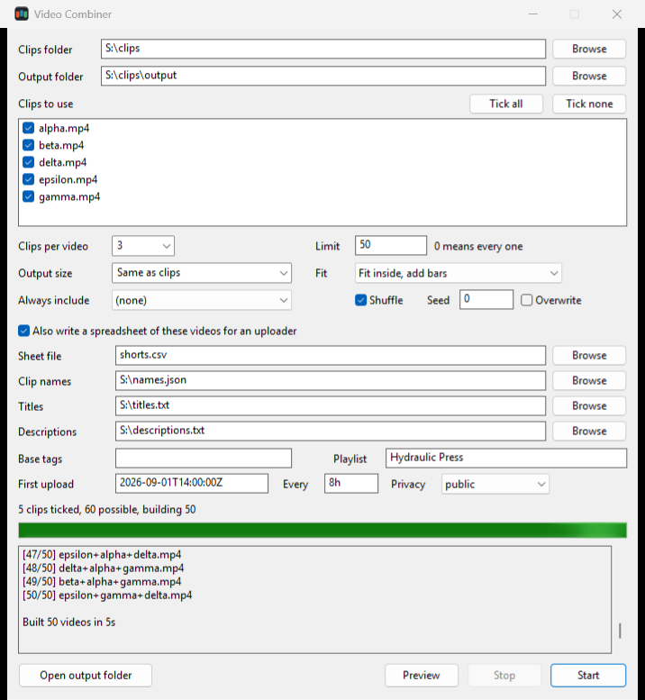
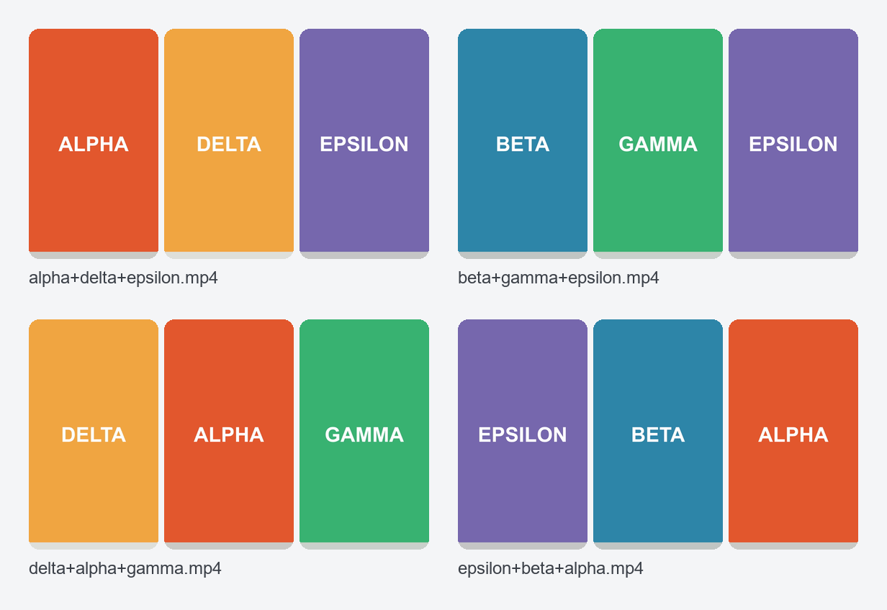

# Video Combiner

Video Combiner takes a folder of clips and builds a video out of every combination of them. Five clips at three per video make 60 videos, each with the clips in a different order, and ten clips make 720. It's meant for shorts and TikTok channels that get a lot of uploads out of a few recorded clips.

<p align="center">
  
</p>

There's a Windows app and a command line tool. Both run the same engine, and the command line tool also builds on macOS and Linux.

## Download

Get the zip for your system from the [releases page](https://github.com/HBProductionOfficial/VideoCombiner/releases). You also need [ffmpeg](https://ffmpeg.org/download.html) with `ffprobe`, which `winget install Gyan.FFmpeg` installs on Windows.

## Using the window

Open `videocombiner-gui.exe`, pick the clips folder, tick the clips you want and press Start. Before anything is built, the window tells you how many videos your settings will make, and Preview lists them without writing a file.

<p align="center">
  
</p>

## Using the command line

```
videocombiner -i clips -o shorts                      # every 3-clip ordering
videocombiner -i clips --dry-run                      # list the plan, build nothing
videocombiner -i clips -o shorts --limit 50 --seed 42 # 50 videos, same ones every run
videocombiner -i clips -s tiktok --fit blur           # 1080x1920 over a blurred background
```

`videocombiner --help` lists every option. Settings you always use can go in a `videocombiner.json` next to where you run it, and `videocombiner.example.json` shows every key.

## How many videos you get

With n clips and three per video the count is n × (n − 1) × (n − 2). Pass `--unordered` to use each set of clips once instead of in every order. If the total is huge, the tool asks for `--limit` and picks a random sample.

## Spreadsheet export

`--export shorts.csv` writes a row per video for uploaders that read from a Google Sheet: filename, title, description, tags, scheduled time, playlist and privacy. Titles and descriptions come from template files with placeholders such as `{a}` and `{and}`, and `--schedule-every 8h` spaces the uploads out. The `examples/` folder has working files.

## Mixed footage

If the clips differ in size, frame rate, codec or audio, each one is converted once to a common format and every video is then joined without re-encoding. Clips without sound get a silent track, and volume is levelled to -14 LUFS so it doesn't jump at the cuts.

## Building from source

You need CMake 3.16 or newer and a C++17 compiler. On Windows that can be MSVC or MinGW.

```
cmake -S . -B build -DCMAKE_BUILD_TYPE=Release
cmake --build build --config Release
```

Windows builds give you `videocombiner.exe` and `videocombiner-gui.exe`. For the tests, configure with `-DVIDEOCOMBINER_TESTS=ON` and run `ctest --test-dir build`, and `tests/render_smoke.sh` builds real videos with ffmpeg and checks them.
